# Submission

## Candidate
- **Name:** Harsh Vivek Londhekar
- **Assignment chosen:** B (Workflow): Durable Campaign Dispatcher
- **Time spent (honest estimate):** 3.5–4 hours

## How to run
Python 3.11+ (developed on 3.12). No extra dependencies beyond `requirements.txt`.

```bash
# setup (from a clean clone)
python3 -m venv .venv && source .venv/bin/activate
pip install -r requirements.txt

# terminal 1: the mock provider
cd assignment-b-workflow && python -m mock_telephony          # add --failure-scale 0 / --speed 1200 / --seed N as needed

# terminal 2: the dispatcher. Runs until every lead is final, writes ./final_state.csv, exits 0.
cd solution && python -m dispatcher
# After a kill -9, run the same command again: it resumes from data/dispatcher.db.

# check a run (from the repo root): prints /admin/report and diffs final_state.csv against /admin/leads
python solution/scripts/verify.py

# tests (from the repo root): 192 tests, about 1 second, no network
pytest

# chaos: 6 parallel trials (own mock, seed, ports and DB each), failures on, 3-6 random kill -9s each
solution/scripts/run_chaos.sh                                  # PY=python solution/scripts/run_chaos.sh if your venv isn't .venv
python solution/scripts/run_trial.py --seed 42 --kills 3       # a single trial
```

Useful flags: `--db PATH` (state file, default `data/dispatcher.db`), `--out PATH` (default `final_state.csv` at
the repo root), `--provider URL`, `--port 8200` (webhook receiver). `GET http://127.0.0.1:8200/status` shows live
progress per campaign, in-flight calls per tenant, and dispatch/reconcile counters.

## Design

**One process, a SQLite state machine, three asyncio loops.** I didn't use Temporal (reasoning in the decisions table).

```text
                     ┌──────────────── dispatcher process (one asyncio event loop) ────────────────┐
fixtures/ ─ config ─►│                                                                             │
                     │   dispatcher loop (every 20 ms)  ── reserve() ─┐     POST /v1/calls ───────►│
                     │   webhook receiver  :8200        ── apply_result()──►  SQLite (WAL)          │  mock
                     │   reconciler loop (every 250 ms) ── apply_result()/resolve ─┘               │  provider
                     │                                  ◄──── signed webhooks / GET /v1/calls ─────│
                     └─────────────────────────────────────────────────────────────────────────────┘
```

| Module | Role |
|---|---|
| `windows.py`, `policy.py` | **Pure** scheduling rules (no I/O, time passed in): window maths, next eligible time, retries, callbacks, priority, DND precedence. Most unit tests target these two. |
| `store.py`, `db.py` | All state. Each write method is **one `BEGIN IMMEDIATE` transaction**. `apply_result()` is the only code path that applies a call outcome. |
| `dispatcher.py` | Each tick, per tenant: free slots → due leads in priority order → `reserve()` → POST in a background task. |
| `webhooks.py` | HMAC check on the raw body → `apply_result()` → 2xx. Also `/status`. |
| `reconciler.py` | Resolves `unknown` calls via `GET ?request_id`; polls `active` calls that should have ended (lost webhooks). |
| `app.py` | Startup order: clock sync → open/seed DB → **recover orphaned dials** → start webhook server → dispatch. |

**Lead lifecycle**

```mermaid
stateDiagram-v2
    [*] --> Fresh: loaded (priority 2)
    Fresh --> InCall: window open, tenant slot free, phone free
    Retry --> InCall: next_eligible_at reached (priority 1)
    Callback --> InCall: callback due (priority 0, dialled first)

    InCall --> Fresh: 503 / not placed (no attempt counted; same class if it was a retry or callback)
    InCall --> Retry: no_answer / busy (+60m) or failed (+15m), attempts < 3
    InCall --> Callback: callback_requested, attempts < 3
    InCall --> Completed: interested / not_interested / wrong_number / dnd
    InCall --> Exhausted: no terminal disposition and attempts == 3

    Fresh --> DndBlocked: same phone said "dnd" in another lead
    Retry --> DndBlocked: same phone said "dnd" in another lead
    Callback --> DndBlocked: same phone said "dnd" in another lead

    Completed --> [*]
    Exhausted --> [*]
    DndBlocked --> [*]
```


"InCall" isn't stored on the lead. It's derived from the lead having a call row in `dialing | unknown | active`.
Next-eligible times are always snapped to the next opening of the campaign window ∩ 09:00–21:00.

**Call (attempt) lifecycle**

```text
 reserve() ─► dialing ──201/200──► active ──webhook or poll──► ended
                 │──503──────────► not_placed  (slot freed; next try reuses the same request_id)
                 │──504/timeout──► unknown ──GET ?request_id── found ──► active / ended
                 │                                         └── 404 ────► not_placed
                 └──(webhook arrives before the 201)──────────────────► ended  (a late 201 never reverts it)
```

**How at-most-once dialling is guaranteed**
1. **Decide, then commit, then dial.** `reserve()` checks, inside one write transaction, that the lead is pending, has
   attempts left, its phone isn't DND, the tenant is under its limit, and the phone/lead has no call in flight. It then
   inserts the call row as `dialing` with `request_id = "{campaign}:{lead}:{attempt_no}"`. The POST is only sent after
   the commit.
2. **The request_id is deterministic per attempt slot.** Whatever happens to the process after the commit, the row and
   its key survive. On restart every `dialing` row is resolved with `GET /v1/calls?request_id=…`. If a POST is ever
   re-sent, it carries the same key, so the provider returns the existing call instead of placing a second one.
3. **The slot and phone stay held from reservation until the result is applied.** Our view of "in flight" is always
   at least as strict as the provider's. The slot is released in the same transaction that applies the outcome and
   propagates DND. So even when a `dnd` webhook is lost and recovered by polling 30 sim-minutes later, no other lead
   with that phone can be dialled in the meantime.
4. **The database enforces it too.** Unique partial indexes allow only one in-flight call per phone (R3) and per lead,
   even if the application logic had a bug.
5. **Attempts are counted, not incremented.** `attempts = COUNT(calls WHERE accepted)`, and `accepted` is set only on
   proof (201/200, a GET that finds the call, or a result for it). 503s and confirmed-not-placed 504s never count
   (R4), and duplicates can't double-count.

## Decisions & assumptions

| Decision | Why | Alternative considered |
|---|---|---|
| SQLite state machine in one asyncio process, not Temporal | Fits the time box, needs no external server, survives `kill -9` (committed WAL transactions). I can point at the exact transaction that makes each step safe. The hard part (idempotent dialling via `request_id`) is the same either way. | Temporal: durable timers/retries for free, but tenant-wide concurrency across workflows needs a separate semaphore, and it's more infrastructure to run and explain. Postgres: same design, needed for multi-host. |
| `request_id = campaign:lead:attempt_no`, written before the POST | Crash-safe and replay-safe; one provider call per attempt slot; readable in logs. | Random UUID stored before the POST (equally safe, harder to debug). |
| Slot/phone held until the result is applied, not until the provider's `ended_at` | Never exceeds the provider's view (R2/R3). Costs a little throughput when webhooks are late. | Free the slot at `ended_at` (would trust webhook timing). |
| 503 → back to the scheduler with a 45 sim-s backoff | Every POST re-checks the window, priority and limits first. | Inline retry loop (could dial after the window closed). |
| 504 / timeout / connection error → `unknown`, then `GET ?request_id`: found = placed, 404 = not placed | The mock registers a call before its 504 delay, so the GET is definitive. Keeps the slot held until known. | Blindly re-POST the same key (safe from duplicates, but could place a call late, after the window closed). |
| Poll `active` calls older than 8 sim-min, re-poll every 2 sim-min | The longest simulated call is ~6.5 sim-min, so a missing result by then means the webhook was lost. | Long timeout only (slots and retries stall for longer). |
| Don't start calls in the last `max(60 s, 0.05 s × speed)` sim of a window; start exactly at opening | Absorbs HTTP latency at any `--speed` without leaning on the provider's 120 s grace. | Use the grace (risky if latency spikes). |
| Priority ties: earliest `next_eligible_at`, then `campaign_id`, `lead_id` | Deterministic; longest-waiting first. Both acme campaigns share one pool of 4 slots. | Round-robin across campaigns; deadline-aware (renewals closes earlier). |
| `callback_requested` on the 3rd attempt → `exhausted` | The R4 cap wins; matches the provider's precedence. | – |
| DND propagation: other pending leads with that phone → `dnd_blocked`, or `exhausted` if they're already at 3 attempts | R9 precedence `completed > exhausted > dnd_blocked`. A final lead is never moved to a weaker state. | – |
| `callback_requested` with no `callback_at` → normal retry (+60 min) | We can't honour an unknown time; retrying is the safe fallback. | Call immediately (could be too early). |
| Unknown call status → the longest retry delay | Too early is a violation; too late isn't. | Treat as `failed` (+15 min). |
| Phones sent exactly as in the CSV; customer names never loaded | The provider matches raw strings (normalising would cause `unknown_lead`). Names are PII we don't need. | Normalise to E.164 (breaks matching with this provider). |
| Duplicate `lead_id` in a CSV → last row wins (logged); rows missing an id or phone are skipped (logged) | Matches how the provider reads the same file. | First wins (provider would reject our calls if the phones differ). |
| Bad config (unknown tenant, malformed or midnight-crossing window, window never inside 09–21) → refuse to start | Dialling with a misread rule is worse than not dialling. | Best-effort start. |
| DB from an **earlier provider run** → archived automatically and a fresh run starts; DB built from **different fixtures** in the same run → refuse to start | Stale attempt counts against a restarted mock are meaningless, and re-runs in one clone must just work. A fixtures mismatch mid-run is ambiguous and unsafe to guess about. | Always refuse (breaks repeated trials); always wipe (could hide a real problem). |
| Bad signature → 401 and stored for audit; unknown or mismatched call → 200 and logged | Never trust unsigned input; a non-2xx for a valid but unusable body only triggers useless redeliveries. | – |
| 409/429/422 rule rejection → treated as not placed, 10 sim-min backoff, logged as `VIOLATION` | These are bugs, not a normal path. Never seen in any run. | Crash the process. |
| Webhook receiver in the same process as the dispatcher | Simplest. A `kill -9` takes both down, but correctness never depends on webhooks: the provider redelivers for ~7 s, and polling covers the rest. | Separate receiver process (more moving parts, same guarantees). |
| Exit 0 after writing the CSV; a re-run after completion just rewrites the CSV | Makes "run until done" and "restart after kill" the same command. | Keep serving. |

## Failure modes considered

| What goes wrong | How it's handled |
|---|---|
| 503 | Not placed: slot freed, no attempt counted, retried after 45 sim-s with the same `request_id`. |
| 504 (placed or not), HTTP timeout, dropped connection | `unknown` (slot held) → `GET ?request_id` → accepted (applying the result if already ended) or not placed. If the GET fails too, the reconciler retries. |
| Webhook delivered twice | `apply_result()` sees the call is already `ended` → `duplicate`, no change. |
| Webhook never delivered | The reconciler polls calls still `active` 8 sim-min after reservation and applies the polled result through the same code path. |
| Webhook arrives before we read the 201 | The call row already exists (`dialing`), so the result is applied by `request_id`. The late 201 only records the `call_sid` and never revives the call. |
| Forged or tampered webhook | HMAC-SHA256 over the raw bytes, constant-time compare → 401. |
| `kill -9` after reserve, before POST | `dialing` row → on restart GET → 404 → not placed → redialled later with the same key. |
| `kill -9` after POST / before 201 / during a 504 wait | `dialing` row → on restart GET → found → active, or ended with its result applied. |
| `kill -9` while handling a webhook | The transaction rolls back; the provider redelivers (1, 2, 4 s), or the reconciler polls. |
| Down longer than the provider's ~7 s redelivery window | Those results are gone from the webhook path; polling recovers them (seen in the chaos runs: `gave_up: 7`, all recovered). |
| Crash during recovery itself, repeatedly | Recovery only reads the provider and applies idempotent transitions; tested with several back-to-back crashes. |
| Crash while writing `final_state.csv` | Written to a temp file, fsynced, then `os.replace`, so a reader never sees half a file. |
| Mock restarted with a new seed, old DB still on disk | Detected via the provider's `real_epoch`; the old DB is archived and a fresh run starts. |
| Window closes while leads are queued | Leads are pushed to the next opening (with the end margin), not dialled late. |
| Same phone in two campaigns | Skipped while the other call is in flight (never blocks the queue), plus the DB unique index. |
| Dirty fixtures | Validated at load (see decisions). |

**Known not handled**
- **Two dispatcher processes on the same DB.** There is no lease or owner column, so a second process's startup
  recovery would treat the first's in-progress dials as orphans. Run one instance. The fix is an owner + heartbeat on
  `calls`.
- **A real carrier with lagging lookups.** A 404 right after a 504 could be stale. Reusing the same `request_id` still
  prevents a second call, but our slot accounting could briefly under-count. I'd delay or repeat the lookup before
  trusting a 404.
- **A lead the provider permanently refuses** (`400` / `unknown_lead`) is retried hourly and keeps the run from
  finishing. It's logged loudly. Ideally it should get a fourth, operator-visible final state.
- **Remote provider clocks.** Simulated time is computed from the local `time.time()`, which is exact here because
  both processes share a machine. Against a remote provider I'd re-sync from `/v1/clock` regularly.
- **PII at rest:** phones are stored unencrypted in the SQLite file (names aren't stored at all). There's no handling
  for a full disk or a corrupted DB.
- **Graceful shutdown on SIGTERM** isn't special-cased. It's treated like a crash, which is safe but slower to resume.

## Testing

`pytest` runs **192 tests in about 1 s** with a fake clock and a fake provider: no network and no waiting on the mock.

| File | # | What it pins down |
|---|---|---|
| `test_windows.py` | 36 | `[start, end)` boundaries, weekday rules (zen Fri→Mon, renewals Sat→Mon), IST vs UTC dates, intersection with 09–21, end margin, plus a property check over a week sampled every 7 min that `next_open` is the earliest open instant |
| `test_policy.py` | 44 | R4/R5/R6/R7/R8/R9: retry delays measured from `ended_at` and snapped to the window, callbacks inside/outside the window, precedence, payload parsing |
| `test_priority.py` | 8 | Callbacks > retries > fresh, not-yet-due leads ignored, busy phone skipped not waited on, shared phone picked once, closed campaign skipped |
| `test_store.py` | 31 | Every transition; R2 shared across campaigns; R3 by app check *and* by DB index; duplicates; webhook-before-201; DND propagation and precedence; durability across reopen; transaction rollback |
| `test_dispatcher.py` | 13 | Fills tenants to their limit; closed windows deferred; end margin; callback first; 503 / 504-found-ended / 504-not-found / unreachable / rule rejection |
| `test_reconciler.py` | 11 | Lost-webhook recovery, poll throttling, late webhook after a poll is a duplicate, unknown → active / released / still held, calls owned by a live dial task are left alone |
| `test_recovery.py` | 8 | DB state left by each crash point → restart → no lost lead, no double dial, slot accounting right; old-run DB archived; fixtures mismatch refused |
| `test_webhooks.py` | 9 | Signature over the exact raw bytes, missing or bad signature, duplicates, invalid JSON, unknown call, `/status` |
| `test_provider.py` / `test_config.py` | 16 / 16 | HTTP status → outcome mapping, timeouts; fixture loading and every config validation error |

I also checked that the tests actually catch bugs by **injecting 7 deliberate bugs** one at a time: closing time
counted as open, attempt cap off by one, same phone picked twice, no tenant limit, late 201 reviving an ended call,
no DND propagation, duplicates re-applied. Each one made at least one test fail.

**End-to-end:** `run_trial.py` / `run_chaos.sh` against the real mock (results below).

**Not tested:** two processes at once; real network latency or partitions; long runs at much larger scale; Temporal.

## Results

All runs: **0 violations** and **200/200 rows** of `final_state.csv` identical to `/admin/leads` (state, attempts,
last status, last disposition).

| Run | Failures | `kill -9`s | Max downtime | Violations | CSV match | Peak concurrency (acme/zen) | Callback lateness p90 |
|---|---|---|---|---|---|---|---|
| seed 7, 600× | off | 0 | – | 0 | 200/200 | 4 / 3 | 0.3 min |
| seed 99, 1200× | off | 0 | – | 0 | 200/200 | 4 / 3 | 6.6 min |
| seeds 1, 2, 3, 7, 42 (600×) and 1337 (1200×) | on | 0 | – | 0 | 200/200 each | 4 / 3 | 1.1–8.7 min |
| seed 11, 600× | on | 3 | 2 s | 0 | 200/200 | 4 / 3 | 1.1 min |
| seed 12, 600× | on | 5 | 2 s | 0 | 200/200 | 4 / 3 | 3.0 min |
| seed 13, 600× | on | 4 | 10 s | 0 | 200/200 | 4 / 3 | 1.2 min |
| seed 14, 1200× | on | 4 | 3 s | 0 | 200/200 | 4 / 3 | 8.3 min |
| seed 15, 600× | on | 6 | 1 s | 0 | 200/200 | 4 / 3 | 3.5 min |
| seed 16, 1200× | on | 3 | 10 s | 0 | 200/200 | 4 / 3 | 7.9 min |

`/admin/report` from seed 15 (failures on, **6 × `kill -9`**):
```json
{
  "calls_total": 408, "calls_active": 0,
  "calls_by_status": {"completed": 237, "no_answer": 100, "failed": 28, "busy": 43},
  "violation_count": 0, "violations_by_type": {},
  "max_concurrency_seen": {"acme_insurance": 4, "zen_retail": 3},
  "callback_lateness_minutes": {"count": 79, "p50": 0.2, "p90": 3.5, "max": 21.1},
  "webhooks": {"delivered": 442, "duplicates": 44, "connect_errors": 30, "lost": 10}
}
```

Observations:
- The kills landed in the hard places. Three trials died mid-dial with 1–4 calls in an unknown state, and all were
  resolved on restart via `GET ?request_id`. In seed 11 the provider gave up on 7 webhooks while we were down, and all
  were recovered by polling. Each run saw 34–51 duplicate webhooks with no effect.
- **Callback lateness** is the weak spot: p50 stays around 0.2 min, but p90 rises to ~8 min at 1200× and the max to
  ~21 min after kills. That comes from restart downtime and from all slots being busy when a callback falls due. It
  isn't a rule violation; it's the first thing I'd improve.
- Most runs finish in 1–2.5 real minutes. Seed 3 took 8: its last zen lead's retry fell after zen's Friday 18:00
  close, and zen doesn't call at weekends, so it correctly idled until Monday 09:30 simulated time.

## If I had another day
1. **Cut callback lateness.** (a) On restart, poll every `active` call immediately instead of waiting for the 8-minute
   staleness threshold, so slots free up straight away. (b) Hold back the last free slot of a tenant from *fresh*
   leads when a callback falls due within about one average call length. Measure p90/max before and after.
2. **Leases for safe horizontal scale:** `owner` + `heartbeat_at` on `calls`, so recovery only adopts dials from dead
   owners; then run two dispatchers on Postgres with `SELECT … FOR UPDATE SKIP LOCKED`.
3. **Observability:** JSON logs with one line per transition (`request_id`, lead, from→to, sim time), and metrics for
   in-flight per tenant, unknown-call age, lost-webhook rate and callback lateness, with alerts on any 4xx rejection.
4. **A fast in-process end-to-end test** (fake provider + fake clock driving the real loops through a full campaign),
   plus property-based tests for `windows` and `policy`.
5. **Operational polish:** graceful SIGTERM, an operator-visible state for leads the provider permanently refuses,
   encrypting phones at rest.

**At 1M leads/day across 50 tenants** (≈12 calls/s average, peaks far higher, all crammed into windows):
- Postgres partitioned by tenant, and indexed "due" queries or a delayed queue instead of scanning pending leads.
- A per-tenant concurrency counter (or token table) updated in the reserve transaction.
- Many dispatcher workers claiming work with `SKIP LOCKED`.
- Webhooks ingested through a queue with dedup on `request_id`, and an outbox for POSTs.
- Polling done in batches rather than per call.
- At that point Temporal, or a timer service for per-lead durable timers, becomes worth its operational cost.
