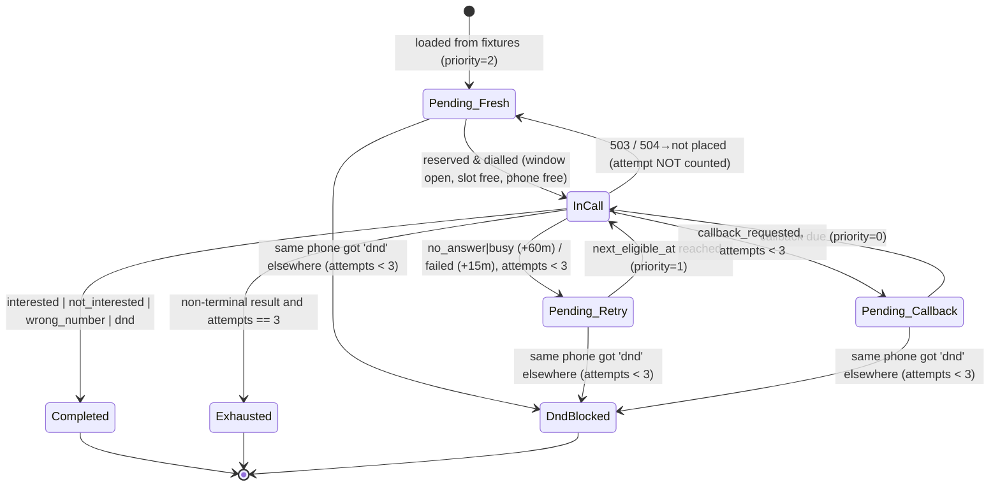

# Plan: Assignment B, Durable Campaign Dispatcher

Source repo: https://github.com/AryamannNingombam/sde-assignment-junior-2026
Spec: `assignment-b-workflow/README.md` · Glossary: `docs/GLOSSARY.md`
Time box: 6–8 focused hours (72h wall clock). Python 3.11+.

---

## 0. What we're building, in one paragraph

A long-running service that loads 3 campaigns / 200 leads from `fixtures/`, and dials them through the
mock carrier (`http://127.0.0.1:8099`). It receives signed result webhooks on `http://127.0.0.1:8200/webhooks/telephony`
and decides each lead's next step (retry, callback, done). It stops when every lead is `completed`,
`exhausted` or `dnd_blocked`, then writes `final_state.csv`. It must get **0 violations** in
`/admin/report`, and its CSV must **match `/admin/leads`**, even when the provider returns 503s,
ambiguous 504s, duplicate or lost webhooks, and the grader runs `kill -9` on the process at random points.

**Grading in practice:** they start the mock with an **unseen seed** (outcomes change, the fixtures probably
don't). They run the service, kill it a few times, then check `violation_count` and diff the CSV.

---

## 1. Facts from reading the mock's source (`mock_telephony/server.py`)

These details aren't all spelled out in the README, and they drive the design:

| Fact | Consequence for us |
|---|---|
| Sim clock: `sim_now = sim_epoch + (time.time() - real_epoch) * speed`. Default 600× means **1 real second = 10 sim minutes**. Start: **Thu 12 Nov 2026 17:30 IST**. | Calls last only **~5–650 ms of real time**. The dispatcher loop must be fast (tick of about 20–50 ms real). Read `speed` from `/v1/clock` and never hard-code it (graders may use `--speed 1200`). |
| Call durations (sim): failed 3–10 s, busy 5–12 s, no_answer 30–45 s, completed 15–30 s ring + 60–360 s talk. | A call that has been active for more than ~7 sim min has almost certainly ended, so its webhook was probably lost. That is the threshold for polling. |
| The provider checks rules **in this order**: window → DND phone → lead already terminal → max attempts → same phone active (409) → tenant concurrency (429) → retry too early → callback too early. Every rejection is a **violation**. | We must never send a request that could be rejected. All checks happen on our side *before* the POST. |
| 503 (5%) and the "pre-check" 504 (2%) happen **before** the call is registered, so the call is not placed. The "post-accept" 504 (4%) happens **after** the call is registered (attempt counted, call running). Both 504s **sleep 2 real seconds** (~20 sim min at 600×). | After a 504, `GET /v1/calls?request_id=…` gives a definite answer: found means placed, 404 means not placed. The call can **finish and its webhook can arrive while we're still waiting on the 504**. |
| Replaying a known `request_id` returns 200 with the existing call. It is checked first, before failure injection. | Re-sending the same `request_id` is always safe. That makes crash recovery simple. |
| Webhooks: 3% are **lost** for good, 10% are **duplicated**. Redelivery on non-2xx or connection error uses **real-time** backoffs of 1, 2 and 4 s, then the provider gives up. | If we're down for more than ~7 real seconds (≈70 sim min), those results are gone for good. **Polling is mandatory.** |
| The provider frees the tenant/phone slot at call end, **before** sending the webhook. | Our view of "active" lags behind the provider's. That's safe, because we're stricter than needed. |
| Window check uses ±120 s grace (`window_grace_seconds`). Retry/callback "too early" checks also allow 120 s grace. | We check exact windows ourselves with a small safety margin before the window ends. The grace absorbs HTTP latency. |
| `callback_lateness` is measured from `next_open(callback_at, campaign window)` to the moment of dialling. | To minimise it, dial due callbacks first and quickly. |
| `/admin/leads` precedence: `terminal → completed`; else `attempts >= max and not busy → exhausted`; else `phone in dnd and not busy → dnd_blocked`; else `incomplete`. | Our final-state derivation must match this logic exactly. |
| The provider validates `W.leads[(cid, lid)] == phone` using the **raw string**. DND and same-phone checks also use raw strings. | Send the phone **exactly** as written in the CSV. Don't reformat it. |
| Unknown lead or wrong phone returns 422 `unknown_lead` (not a recorded violation). Missing field returns 400. | Validate the fixtures when loading them. |

### Fixture facts (checked)
- 200 leads: `c_acme_feedback` 60, `c_acme_renewals` 70, `c_zen_winback` 70. No duplicate IDs, no empty
  fields, all phones in the `+91XXXXXXXXXX` format. (Still validate defensively, since graders may use other fixtures.)
- **15 phones appear in both `c_acme_feedback` and `c_acme_renewals`**, which tests R3 and R8.
- Tenants: `acme_insurance` max 4 concurrent calls (shared by renewals and feedback). `zen_retail` max 3.
- Windows (IST), all inside 09:00–21:00:
  - `c_acme_renewals` 10:00–19:00 Mon–Sat
  - `c_acme_feedback` 11:00–20:30 every day
  - `c_zen_winback` 09:30–18:00 Mon–Fri. **Only 30 minutes on Thu**, then Fri, then closed until **Mon**.
- Retry policy: no_answer/busy 60 min, failed 15 min. `max_attempts` = 3 everywhere.
- Expect a full run to reach into Sat/Mon sim time (a few real minutes). Weekend gaps are normal.

---

## 2. Architecture decision

**Choice: one Python process with asyncio, a SQLite-backed state machine, a FastAPI webhook receiver, and a
dispatcher plus reconciler as background tasks.** (Temporal is listed as an optional stretch only.)

Why:
- In the time box, a DB state machine is easier to reason about and explain in the interview. You
  can point at the exact row and transaction that makes each step safe.
- SQLite is in the standard library, so it works from a clean clone with no Docker. WAL mode plus committed transactions survive
  `kill -9`, because a process crash doesn't lose committed data.
- One asyncio event loop means "check limits and reserve the slot" runs with no `await` in between. That
  makes it atomic within the process. We still use `BEGIN IMMEDIATE` and DB constraints so it stays correct if a
  second process is ever added (horizontal-scale stretch).
- Killing the process also kills the webhook receiver. That's acceptable because **we never depend on webhooks
  for correctness**. They only make things faster, and polling is the safety net.

Alternative to mention in `SUBMISSION.md`: with Temporal, each lead is a workflow, and timers and retries
are durable automatically. Dialling becomes an activity with the `request_id` as its idempotency key, and
webhooks become signals. Concurrency limits across workflows need a separate mechanism (a semaphore
workflow or a DB). Temporal adds an external server and more moving parts, and the hard part (at-most-once
dialling via `request_id`) is the same either way.

Dependencies: already in `requirements.txt` (fastapi, uvicorn, httpx, pytest). Optionally add `pytest-asyncio`.
Use `zoneinfo` (stdlib) for `Asia/Kolkata`, or a fixed `+05:30` offset (IST has no DST).

---

## 3. Repository layout

Start from a clone of the original repo, keep the original files unchanged, and put everything new in `solution/`.

```
solution/
├── README.md                 # how to run (mirror into SUBMISSION.md)
├── dispatcher/
│   ├── __init__.py
│   ├── __main__.py           # CLI: python -m dispatcher [--db ...] [--port 8200] [--provider ...] [--out ...] [--reset]
│   ├── config.py             # load + validate campaigns.json and lead CSVs → dataclasses
│   ├── clock.py              # SimClock (synced from /v1/clock) + FakeClock for tests
│   ├── windows.py            # PURE: is_open(t, window), next_open(t, window), intersect with regulatory
│   ├── policy.py             # PURE: next eligible time, priority class, final-state derivation, terminal sets
│   ├── db.py                 # connection, PRAGMAs, schema, migrations, `transaction()` context manager
│   ├── store.py              # all SQL: seed leads, pick candidates, reserve, mark accepted, apply_result, ...
│   ├── provider.py           # httpx client → typed outcomes (Accepted / NotPlaced / Unknown / Rejected)
│   ├── dispatcher.py         # loop: pick eligible leads → reserve → spawn dial task
│   ├── reconciler.py         # resolve orphaned/unknown dials, poll stale active calls (lost webhooks)
│   ├── webhooks.py           # FastAPI router: HMAC verify → apply_result
│   ├── output.py             # final_state.csv writer (atomic: tmp file + os.replace)
│   └── app.py                # wiring + lifespan (startup recovery → start loops)
├── tests/
│   ├── conftest.py
│   ├── test_windows.py
│   ├── test_policy.py
│   ├── test_priority.py
│   ├── test_store.py         # state transitions on a temp SQLite DB
│   ├── test_webhooks.py      # signature, duplicates, webhook-before-201
│   ├── test_dial_outcomes.py # 503/504/timeouts with a fake provider client
│   └── test_recovery.py      # crash-point simulations (rows left in 'dialing' etc.)
└── scripts/
    ├── run_chaos.sh          # start mock (seed N) → run dispatcher → kill -9 randomly → restart → verify
    └── verify.py             # diff final_state.csv vs /admin/leads and print /admin/report summary
```

Keep `windows.py` and `policy.py` **pure** (no I/O, time passed in as an argument). That's where the
spec's scheduling rules live, it's what the reviewers want tested, and it's where you'll make most
live-interview changes.

---

## 4. Time model

- Represent all sim instants internally as **timezone-aware datetimes**, and store them in the DB as **UTC epoch
  seconds (REAL)** so SQL comparisons are trivial. Convert to IST only inside `windows.py`.
- `SimClock`: on startup, `GET /v1/clock` gives `sim_epoch`, `real_epoch` and `speed`. Then
  `now() = sim_epoch + (time.time() - real_epoch) * speed`. No polling is needed (same machine, same `time.time()`).
  Re-sync every so often (for example every 30 s real) just in case.
- `FakeClock` for tests: `now()` returns a settable value, and `advance(minutes=…)`.
- Persist `real_epoch` and `sim_epoch` in a `meta` table. On startup, if the DB's epoch differs from
  the provider's, **this DB belongs to a previous mock run**: refuse to start, or wipe it with `--reset`
  (pick one and document it). This prevents re-sending stale `request_id`s and keeping stale counts after the mock restarts.
- Safety margins are in sim seconds but derived from real latency: `END_MARGIN = max(60, 0.05 * speed)` sim
  seconds. Don't *start* a call if `now >= window_end - END_MARGIN`. The provider's 120 s grace covers
  the rest.

---

## 5. Window maths (`windows.py`)

A lead's campaign is callable at `t` iff `t` is inside the campaign window **and** inside the regulatory window
(09:00–21:00, every day). Treat the effective window as the **intersection** for each allowed day:
`[max(c.start, reg.start), min(c.end, reg.end))` on `c.days`. Today every campaign window sits inside the regulatory one,
but the interviewers may change that live.

Functions:
- `is_open(t, campaign) -> bool`: half-open interval `[start, end)`, day of week computed in IST.
- `next_open(t, campaign) -> datetime`: earliest instant `>= t` inside the effective window. It scans up to 8 days
  ahead and handles "before today's start", "inside", "after today's end" and "day not allowed".
- `window_end(t, campaign) -> datetime`: close of the window containing `t` (for the end margin).
- `is_startable(t, campaign, margin) -> bool`: `is_open(t) and t < window_end(t) - margin`.

Cases to get right (all become tests):
- Exactly `start` → open; exactly `end` → closed; `end - 1s` → open.
- Thu 17:30 zen (open until 18:00) → open; Thu 18:00 zen → `next_open` = **Fri 09:30**.
- Fri 18:05 zen → **Mon 09:30** (skips Sat and Sun).
- Sat 19:10 renewals → **Mon 10:00** (Sunday not allowed).
- Feedback 20:45 → next day 11:00 (every day is allowed).
- Regulatory intersection: a synthetic campaign window of 08:00–22:00 is effectively 09:00–21:00.
- Midnight crossing and day-of-week calculation done in IST, not UTC (e.g. 02:00 IST is the previous day in UTC).

---

## 6. Data model (SQLite)

```sql
PRAGMA journal_mode = WAL;
PRAGMA synchronous = FULL;      -- NORMAL is enough for kill -9; FULL also covers OS crash; cost is negligible here
PRAGMA foreign_keys = ON;

CREATE TABLE meta (key TEXT PRIMARY KEY, value TEXT NOT NULL);
-- provider_real_epoch, provider_sim_epoch, fixtures_hash, schema_version

CREATE TABLE leads (
  campaign_id      TEXT NOT NULL,
  lead_id          TEXT NOT NULL,
  tenant_id        TEXT NOT NULL,
  phone            TEXT NOT NULL,          -- raw value from CSV, sent verbatim
  state            TEXT NOT NULL,          -- 'pending' | 'completed' | 'exhausted' | 'dnd_blocked'
  priority         INTEGER NOT NULL,       -- 0 = due callback, 1 = retry, 2 = fresh
  next_eligible_at REAL NOT NULL,          -- sim epoch secs; already snapped to next window opening
  callback_at      REAL,                   -- raw callback time (for lateness ordering)
  attempts         INTEGER NOT NULL DEFAULT 0,  -- cached; = count of accepted calls (recomputed in apply_result)
  last_status      TEXT,
  last_disposition TEXT,
  updated_at       REAL NOT NULL,
  PRIMARY KEY (campaign_id, lead_id)
);
CREATE INDEX leads_pick ON leads(tenant_id, state, priority, next_eligible_at);

CREATE TABLE calls (                       -- one row per *attempt slot*
  request_id   TEXT PRIMARY KEY,           -- deterministic: '{campaign_id}:{lead_id}:{attempt_no}'
  campaign_id  TEXT NOT NULL,
  lead_id      TEXT NOT NULL,
  tenant_id    TEXT NOT NULL,
  phone        TEXT NOT NULL,
  attempt_no   INTEGER NOT NULL,
  state        TEXT NOT NULL,              -- 'dialing' | 'unknown' | 'active' | 'ended' | 'not_placed'
  accepted     INTEGER NOT NULL DEFAULT 0, -- 1 once we have proof the provider accepted it
  call_sid     TEXT UNIQUE,
  status       TEXT, disposition TEXT, callback_at REAL,
  started_at   REAL, ended_at REAL, duration_sec INTEGER,
  reserved_at  REAL NOT NULL,              -- sim time we decided to dial
  last_polled_at REAL,
  post_tries   INTEGER NOT NULL DEFAULT 0,
  FOREIGN KEY (campaign_id, lead_id) REFERENCES leads(campaign_id, lead_id)
);
-- Invariants enforced by the DB itself (the final defence for R3 and "one in-flight call per lead"):
CREATE UNIQUE INDEX one_inflight_per_phone ON calls(phone)                WHERE state IN ('dialing','unknown','active');
CREATE UNIQUE INDEX one_inflight_per_lead  ON calls(campaign_id, lead_id) WHERE state IN ('dialing','unknown','active');

CREATE TABLE dnd_phones (phone TEXT PRIMARY KEY, campaign_id TEXT, lead_id TEXT, at REAL);

CREATE TABLE webhook_events (              -- append-only audit ledger (also helps debugging)
  id INTEGER PRIMARY KEY AUTOINCREMENT,
  received_at REAL, delivery_id TEXT, request_id TEXT, call_sid TEXT,
  signature_ok INTEGER, applied INTEGER, raw_body TEXT
);
```

Notes:
- **"In-flight"** = a `calls` row in `dialing | unknown | active`. Both tenant concurrency (R2) and phone lock (R3)
  are computed from in-flight rows. A slot is **held from the moment we commit the reservation until we
  learn the call ended**. That is always at least as strict as the provider's view.
- **`request_id = '{campaign_id}:{lead_id}:{attempt_no}'`**, where `attempt_no = accepted attempts + 1`. It's deterministic,
  so after a crash we can always ask the provider about it, and re-sending it can never create a second call for the same
  slot. A 503 or "not placed" just puts the same row back to `not_placed`, and the next try reuses the same `request_id`.
- `attempts` must equal what the provider counted. It increments **only on proof of acceptance**: 201, 200, a
  GET that finds the call, or a webhook/result for that `request_id`.
- Lead `state` stores only the four lifecycle values. "In a call" is derived from `calls`, so there's one source of truth.

---

## 7. State machines

### 7.1 Lead lifecycle (put this in `SUBMISSION.md`)


(If a 503 hits a retry or callback lead, it goes back to its own pending class, not to Fresh.)

### 7.2 Call (attempt slot) lifecycle

```
            reserve (txn, BEFORE POST)
   (none) ───────────────────────────► dialing
                                         │ POST /v1/calls
        ┌─────────────┬──────────────────┼──────────────────────┬───────────────┐
      201/200       503            504 / timeout / conn err    4xx (violation)   webhook arrives first
        │             │                  │                      │                │
        ▼             ▼                  ▼                      ▼                ▼
      active      not_placed          unknown ──GET ?request_id──┐            ended
        │                                │ found → active/ended   │ 404 → not_placed
        │ webhook / poll result          ▼                        ▼
        └──────────────────────────────► ended  (apply_result, exactly once)
```
`dialing` rows found at **startup** are orphans (we crashed). Treat them as `unknown` and resolve with a GET.

---

## 8. Core flows

### 8.1 Startup (`app.py` lifespan)
1. Open DB, apply schema, sync clock, check `meta` epoch (§4).
2. If leads aren't seeded yet: load and validate fixtures, insert all leads (`pending`, priority 2,
   `next_eligible_at = next_open(now, campaign)`) **in one transaction**. Re-running startup is a no-op (`INSERT OR IGNORE`).
3. **Recovery before dispatching:** for every call in `dialing | unknown`, `GET /v1/calls?request_id=…`
   - found → mark accepted. If `state == ended`, `apply_result(result)`; otherwise `active`.
   - 404 → `not_placed` (frees slot and phone; lead stays pending; attempt not counted).
   - error → keep `unknown` (slot stays held, the reconciler retries).
4. If everything is already final → write CSV and exit (rerun after completion is idempotent).
5. Start uvicorn (webhook receiver), the dispatcher loop and the reconciler loop.

### 8.2 Dispatcher loop (`dispatcher.py`)
Each tick runs every ~20–50 ms real, or immediately when woken by an `asyncio.Event` set after any result:
```
now = clock.now()
for tenant in tenants:
    free = tenant.max_concurrent - count_inflight(tenant)
    if free <= 0: continue
    candidates = SELECT * FROM leads
                 WHERE tenant_id=? AND state='pending' AND next_eligible_at <= now
                 ORDER BY priority, next_eligible_at, campaign_id, lead_id
    for lead in candidates:
        if free == 0: break
        if phone in dnd_phones:            -> mark dnd_blocked/exhausted (defensive), continue
        if phone has an in-flight call:    -> skip (don't block the queue), continue
        if not is_startable(now, campaign): -> next_eligible_at = next_open(now); continue
        if lead.attempts >= max_attempts:  -> defensive: finalize, continue
        reserve(lead)   # BEGIN IMMEDIATE: re-check limits + INSERT/UPDATE calls row state='dialing'; COMMIT
        free -= 1
        spawn dial_task(request_id)        # don't await; other dials proceed
if all leads final and no in-flight calls: write CSV, shutdown
```
- Ordering implements **R6 priority**: due callbacks (0) → retries (1) → fresh (2). Ties go to the earliest
  `next_eligible_at`, then a deterministic campaign_id/lead_id order. Within a tenant, the two acme campaigns
  compete for the same 4 slots, and the ordering decides between them (document this choice).
- `reserve()` re-checks the tenant count inside the transaction. The partial unique indexes reject a second
  in-flight call for the same phone or lead even if the code has a bug. Catch `IntegrityError` and skip.
- Sleep until `min(next_eligible_at)` or the tick limit, whichever comes first, so the loop never busy-waits.

### 8.3 Dial task (`provider.py` + `dispatcher.py`)
```
POST /v1/calls {request_id, campaign_id, lead_id, phone(raw), callback_url}   (httpx timeout ~10 s real)
201/200  → mark_accepted(request_id, call_sid): UPDATE ... SET accepted=1, call_sid=?,
            state = CASE WHEN state IN ('dialing','unknown') THEN 'active' ELSE state END
           (never move 'ended' back to 'active': the webhook may already have arrived)
           recompute lead.attempts
503      → state='not_placed'; lead.next_eligible_at = now + small backoff (30–60 sim s, jitter)
504 / timeout / connection error
         → state='unknown'; immediately try to resolve: GET ?request_id (retry a few times)
           found → accepted (+ apply_result if ended) ; 404 → not_placed ; still failing → leave for reconciler
409/429/422 (violation!) → log ERROR with body; state='not_placed'; long backoff.
           422 dnd_violation → add to dnd_phones and propagate; dial_after_terminal → re-query & finalize.
           These should NEVER happen; if they do it's a bug to fix, not a path to rely on.
400 / 422 unknown_lead → mark the lead as a data error (log, and decide: exclude and report in SUBMISSION).
```
Don't retry a 503 inside the task. Hand the lead back to the scheduler so the window, priority and limits
are checked again before the next POST.

### 8.4 Webhook receiver (`webhooks.py`)
```
POST /webhooks/telephony
raw = await request.body()
expected = hmac.new(secret, raw, sha256).hexdigest()
if not hmac.compare_digest(expected, header['X-AU-Signature']): store event(signature_ok=0); return 401
event = json.loads(raw); store in webhook_events
apply_result(event)            # idempotent
return 200 quickly
```
- Look up the call **by `request_id`** (falling back to `call_sid`). The webhook can arrive before our 201 is processed,
  but our row always exists because we commit `dialing` **before** the POST.
- Unknown `request_id` (shouldn't happen): log it, store it, and return 200. A non-2xx would only cause useless redeliveries.
- Check that `campaign_id`, `lead_id` and `phone` in the body match the row. Log any mismatch.

### 8.5 `apply_result(result)`: the single place a call's outcome is applied
Used by webhooks, polling and recovery, so there's exactly one code path. All in **one transaction**:
1. `SELECT` the call row. If `state == 'ended'` → **no-op** (duplicate webhook, poll after webhook, etc.).
2. Update the call: `state='ended', accepted=1, call_sid, status, disposition, callback_at, started_at, ended_at, duration_sec`.
3. Lead: `attempts = COUNT(calls WHERE accepted=1)`, set `last_status` and `last_disposition` (the most recent ended call
   is this one, because a lead never has two in-flight calls).
4. Decide the next state using pure `policy.next_state(lead, result, campaign, cfg)`:
   - disposition ∈ {interested, not_interested, wrong_number, dnd} → `completed`
     - if `dnd` → `INSERT OR IGNORE dnd_phones`. Then, for **every other lead with that phone** in `pending`:
       `attempts >= max → exhausted`, otherwise → `dnd_blocked`. (They can't be in-flight because of R3, and
       `completed` or `exhausted` leads stay as they are, following the precedence rule.)
   - else if `attempts >= max_attempts` → `exhausted` (this includes a `callback_requested` on the 3rd attempt)
   - else if phone ∈ dnd_phones → `dnd_blocked` (defensive)
   - else if `callback_requested` → pending, priority 0, `next_eligible_at = next_open(callback_at)`
   - else if `no_answer`/`busy` → pending, priority 1, `next_eligible_at = next_open(ended_at + 60m)`
   - else if `failed` → pending, priority 1, `next_eligible_at = next_open(ended_at + 15m)`
5. Commit, then wake the dispatcher.

**Key safety invariant:** the phone lock and tenant slot are released **in the same transaction** that applies
the result, including DND propagation. So once a phone gets `dnd`, no other lead with that phone can be
dialled, even if the webhook was lost and we learned the result by polling 30 sim minutes later.

### 8.6 Reconciler loop (`reconciler.py`), the fix for lost webhooks and unknowns
Every ~0.5 s real:
- `unknown` calls (not currently owned by an in-process dial task) → `GET ?request_id` → resolve as in §8.1.
- `active` calls where `now - reserved_at > STALE_AFTER` (≈7–8 sim min, longer than the longest call) and
  `last_polled_at` older than a short interval → `GET /v1/calls/{call_sid}`. If `ended` → `apply_result(result)`.
- Keep an in-memory set of `request_id`s with a dial task in flight, so the reconciler never races a
  live POST. After a restart that set is empty, so startup recovery owns all orphans.

Polling is cheap (200 leads), so a short `STALE_AFTER` is fine. The sooner we learn a result, the sooner the slot
frees up and retries or callbacks happen.

### 8.7 Completion and output (`output.py`)
- Done when every lead is in `completed | exhausted | dnd_blocked` **and** there are 0 in-flight calls.
- Write `final_state.csv` sorted by `campaign_id, lead_id` with columns
  `campaign_id,lead_id,final_state,attempts,last_status,last_disposition` (empty strings for no call or a null disposition).
  Write to a temp file, then `os.replace` (atomic). Default path: the repo root or `--out`. It's gitignored either way.
- Exit with code 0. Running the program again after it's done just rewrites the CSV and exits.

---

## 9. The crash-point checklist (the README's hint, answered)

"What if the process dies right here?". Each point has to be safe:

| # | Crash point | State left in DB | What happens on restart | Why it's safe |
|---|---|---|---|---|
| 1 | After choosing a lead, before reserve commits | nothing | lead picked again normally | nothing was sent |
| 2 | After reserve commit, before POST is sent | call `dialing` | GET ?request_id → 404 → `not_placed` → redial with **same** request_id | slot was held while dead; no double dial possible |
| 3 | After POST sent, before response read | `dialing` | GET → found → accepted (and `apply_result` if ended) | provider dedupes on request_id |
| 4 | After 201 read, before commit | `dialing` | same as 3 | same |
| 5 | Waiting on a 2 s 504 | `dialing` | same as 2/3 | GET is authoritative in the mock |
| 6 | Mid-webhook, before commit | call `active` | provider sees connection error → redelivers (1/2/4 s); if missed → reconciler polls | `apply_result` is idempotent |
| 7 | After result commit, before next scheduling | lead already has next state | nothing to do | outcome and next state are one transaction |
| 8 | During DND propagation | – | can't be partial: one transaction | atomic |
| 9 | While writing CSV | partial temp file | CSV rewritten from DB | `os.replace` is atomic |
| 10 | Down for >7 real s | some webhooks given up | reconciler polls stale `active` calls | never rely on webhooks |

Known residual risk (write it in `SUBMISSION.md`): with a real carrier, a GET that returns 404 right after a 504
might be a stale read. The mock registers a call before it sleeps, so 404 is definitive here. In
production you'd keep reusing the same `request_id`, which this design already does, so a late placement still dedupes.

---

## 10. Rule-by-rule enforcement map

| Rule | Enforced where | Test |
|---|---|---|
| R1 window | `windows.is_startable` checked right before `reserve()`; `next_eligible_at` is snapped with `next_open` | `test_windows.py` (boundaries, days, intersection, margin) |
| R2 tenant concurrency | `count_inflight(tenant)` inside the `BEGIN IMMEDIATE` reserve; slot held until result is applied | `test_store.py`: 5th reservation for acme refused, including across both campaigns |
| R3 one call per phone | in-flight phone check + **partial unique index** | `test_store.py`: renewals + feedback lead with the same phone, second reserve fails |
| R4 max attempts | attempts counted only on proof of acceptance; `attempts < max` before reserve; deterministic request_id per slot | 503 doesn't increment; 504→found increments once; duplicate webhook doesn't double count |
| R5 retry delay | `policy.next_state` measured from `ended_at` | no_answer at 18:42 → 19:42 (then snapped to window) |
| R6 callbacks + priority | priority classes 0/1/2; `next_open(callback_at)` | callback outside window → next opening; ordering test |
| R7 terminal | `completed` leads are never selected | terminal then duplicate webhook → still completed, no new call |
| R8 DND global | `dnd_phones` + propagation in the same txn as the result | DND in feedback blocks renewals lead; exhausted lead stays exhausted |
| R9 no lost leads | loop exits only when all 200 are final and 0 are in-flight; reconciler resolves everything | final derivation test vs precedence |

---

## 11. Testing plan

Run all tests with one command: `pytest solution/tests -q`. Use a **fake clock everywhere** and never wait on the mock in unit tests.

1. **`test_windows.py`**: every case listed in §5, as parametrised tests with explicit IST datetimes.
2. **`test_policy.py`** (next eligible time):
   - no_answer/busy → `ended_at + 60m`, failed → `+15m`, then snapped to the window (e.g. renewals no_answer at
     18:30 Thu → 19:30 is closed → **Fri 10:00**).
   - callback at 20:15 for renewals (closes 19:00) → Fri 10:00. Callback at 19:30 for feedback → 19:30 itself.
   - callback on the 3rd attempt → `exhausted`.
   - each terminal disposition → `completed`. DND propagation and precedence (completed > exhausted > dnd_blocked).
3. **`test_priority.py`**: given a set of eligible leads (callback, retry, fresh, mixed `next_eligible_at`),
   the pick order is callbacks → retries → fresh. A lead whose phone is busy is skipped, not blocking the queue.
   Tenant slots are respected across campaigns.
4. **`test_store.py`**: on a temp SQLite file: reserve/accept/apply transitions, unique-index protection,
   attempts counting, idempotent `apply_result`.
5. **`test_webhooks.py`** (FastAPI `TestClient`): valid signature → 200 and applied; bad or missing signature → 401
   and not applied; the same body twice → applied once; webhook **before** 201 → ended, then 201 doesn't revert
   it to active.
6. **`test_dial_outcomes.py`**: a fake provider client returning 201 / 503 / 504-placed / 504-not-placed /
   timeout / 429. Check the resulting DB state and attempt counts.
7. **`test_recovery.py`**: build DB states for crash points 2–6 (§9), run startup recovery against the fake
   provider, and check that no lead is lost or dialled twice.
8. **Integration / chaos (not part of the fast suite):** `scripts/run_chaos.sh`
   - start the mock with `--seed $SEED` (try 1, 2, 3, 42, 1337) at `--speed 600` and `--speed 1200`;
   - run the dispatcher, `kill -9` it 3–5 times at random intervals (0.5–5 s), restart each time;
   - at the end run `scripts/verify.py`: print `/admin/report` (`violation_count`, `violations_by_type`,
     `max_concurrency_seen`, `callback_lateness_minutes`, `webhooks`) and diff `final_state.csv` against `/admin/leads`
     (`expected_state` vs `final_state`, `attempts`, `last_status`, `last_disposition`). Exit non-zero on any difference.
   - Optionally a `pytest -m slow` wrapper around it.

---

## 12. Build order (milestones with rough time)

| # | Milestone | Done when | Time |
|---|---|---|---|
| M0 | Clone repo into this folder, venv, run the mock, explore `/docs`, `/v1/clock`, `/admin/*` | mock runs; you can place a call manually with curl | 0.5h |
| M1 | `config.py`, `windows.py`, `policy.py` + their tests | all scheduling tests green | 1.5h |
| M2 | `db.py` schema + `store.py` (seed, pick, reserve, accept, apply_result) + tests | store tests green | 1h |
| M3 | `provider.py`, `dispatcher.py`, `webhooks.py`, `output.py`, `app.py`. Run with **`--failure-scale 0`** | full run: 0 violations, CSV matches | 1.5h |
| M4 | Failure handling: 503, 504 resolution, timeouts, duplicate webhooks, reconciler for lost webhooks. Run at **failure-scale 1** | 0 violations + match on 3 seeds | 1h |
| M5 | Crash recovery: startup recovery, epoch check, `run_chaos.sh`, `verify.py` | 0 violations + match with 3–5 `kill -9`s on several seeds and both speeds | 1h |
| M6 | `SUBMISSION.md` (design, Mermaid diagram, decisions, failure modes, results with a real `/admin/report`), `AI_USAGE.md`, run commands from a clean clone | someone else could run it from the README | 0.75h |
| M7 | One stretch item (see §14) | – | 0.5–1h |

Commit after each milestone (private repo). Don't commit `*.db`, `final_state.csv` or `.env` (already in `.gitignore`).

---

## 13. Decisions & assumptions to record in `SUBMISSION.md`

| Decision | Why | Alternative |
|---|---|---|
| SQLite state machine, single asyncio process | simple, durable on kill -9, explainable | Temporal; Postgres + multiple workers |
| `request_id = campaign:lead:attempt_no`, persisted before the POST | crash-safe and replay-safe; one provider call per attempt slot | random UUID stored before the POST (equally safe, less readable) |
| Slot and phone lock held from reservation until the result is applied | never exceeds the provider's view | releasing on the provider's end time (needs trust in webhook timing) |
| 503 → hand back to the scheduler with 30–60 sim s backoff, same request_id | re-checks window and limits before every POST | inline retry loop (risks dialling after the window closes) |
| 504 → GET ?request_id is authoritative | mock registers calls before the 504 sleep | blind POST replay with the same request_id (also safe, but could place the call late after the window closed) |
| Poll active calls older than ~7 sim min | longest call is about 6.5 sim min, so a missing webhook means it was lost | only poll after a long timeout (slower recovery, slots wasted) |
| Callback on the last attempt → `exhausted` | R4 cap wins; matches provider's precedence | – |
| DND propagation: pending leads with attempts < max → `dnd_blocked`, attempts == max → `exhausted` | R9 precedence | – |
| Priority ties: earliest `next_eligible_at`, then campaign_id, lead_id | deterministic, fair to the oldest | round-robin across campaigns; deadline-aware (renewals closes earlier) |
| Window end margin `max(60 s, 0.05 s × speed)` sim | absorbs HTTP latency at any speed | rely on provider's 120 s grace |
| Phone sent verbatim from CSV | provider matches raw strings | normalising (would cause `unknown_lead`) |
| DB epoch mismatch → refuse (or `--reset`) | stale state from an old mock run is dangerous | silently wipe |
| Bad fixture rows (if any) → skipped and logged | can't be dialled safely | fail the whole run |
| Webhook with bad signature → 401, stored for audit | security | 200 and drop |

---

## 14. Stretch options (pick one, maybe two)

1. **Observability (cheapest, high value):** `GET /status` on the 8200 app showing per-campaign counts per state,
   in-flight per tenant vs limit, unknown calls, next wake-up time and sim time, plus structured JSON logs (one line per transition
   with `request_id`, `lead`, `from→to`). It also helps in the live interview.
2. **Minimise callback lateness:** keep capacity free for imminent callbacks. If a tenant has a callback
   due within roughly an average call length (~4 sim min), don't start a *fresh* call in its last free slot.
   Measure the before/after p50/p90/max from `/admin/report`.
3. **Horizontal scale (two processes):** both use the same SQLite file. `BEGIN IMMEDIATE` serialises reservations,
   and the unique indexes protect R3. You'd need an `owner` and lease/heartbeat column on `calls` so one process's
   reconciler doesn't resolve another's live `dialing` rows, and only one process may run the webhook port
   (or use two ports). More risk, so only attempt it if the core is solid.
4. **1M leads/day × 50 tenants note (writing only):** Postgres with `SELECT … FOR UPDATE SKIP LOCKED`, a per-tenant
   token/semaphore table, sharding by tenant, a timer wheel or delayed queue instead of scanning, webhook ingestion
   via a queue (Kafka/SQS) with dedup keys, outbox pattern, metrics/alerts on violations and lost webhook rates,
   Temporal for per-lead durable timers.
5. **Temporal:** only if you're already comfortable with it. It's a big rewrite, so do it after the core is done, not instead of it.

---

## 15. Definition of done (check before submitting)

- [ ] `pytest` passes with one command from a clean clone.
- [ ] Clean run (`--failure-scale 0`): `violation_count: 0`, CSV == `/admin/leads`.
- [ ] Chaos runs (failure-scale 1, ≥3 seeds, speeds 600 and 1200, 3–5 × `kill -9`): 0 violations, CSV matches, no `incomplete`.
- [ ] `max_concurrency_seen` ≤ 4 for acme and ≤ 3 for zen.
- [ ] No hard-coded speed, dates, ports or secret (all from `campaigns.json` or CLI flags).
- [ ] Original repo files unmodified (`git diff` against upstream shows only `solution/`, `SUBMISSION.md`, `AI_USAGE.md`, and additions to `requirements.txt`).
- [ ] `SUBMISSION.md`: run commands, design, **state diagram**, decisions table, failure modes (handled and **not handled**),
      testing, a real `/admin/report` from a run that included `kill -9`, and "if I had another day".
- [ ] `AI_USAGE.md` filled in honestly (including that an AI helped draft this plan), with at least one example of AI output you rejected or fixed.
- [ ] Private repo, reviewers added, link emailed.

---

## 16. Interview prep (20-min live change)

Likely requirement changes, and where each would go in this design:
- *"Add a per-campaign concurrency cap"* → one more count in `reserve()` plus a config field.
- *"Max N calls per phone per day across campaigns"* → a count over `calls` by phone and IST date, checked in `reserve()`.
- *"New terminal disposition" / "retry delay depends on attempt number"* → `policy.py` only.
- *"Campaign window crosses midnight" / "holidays"* → `windows.py` (+ tests).
- *"Pause/resume a campaign"* → `campaigns_state` table, filtered in candidate selection.
- *"Exponential backoff for failed"* → `policy.next_state`.
- *"Prioritise renewals over feedback"* → the ORDER BY clause / a campaign priority column.

Be ready to explain, without notes: why the reservation is committed before the POST; why the deterministic
`request_id` makes a 504 safe; why the slot is released only in the result transaction; how a lost DND webhook
still can't cause a DND violation; and what happens at each row of §9.
